<div align="center">

# HomeApp

### Your media. Your spending. Your everyday dashboard.

A self-hosted home dashboard that brings movie nights, receipt tracking,
AI conversations, and commute awareness into one place.

[](https://github.com/LuimesLiam/HomeAutomationSystem/actions/workflows/ci.yml)
[](https://github.com/LuimesLiam/HomeAutomationSystem/actions/workflows/release-please.yml)
[](LICENSE)

**Angular 21 · PrimeNG · ASP.NET Core 10 · PostgreSQL · Docker**

[Explore the app](#a-look-inside) · [Get started](#get-started) · [Deploy](DEPLOYMENT.md) · [Screenshot gallery](docs/screenshots/README.md)

</div>

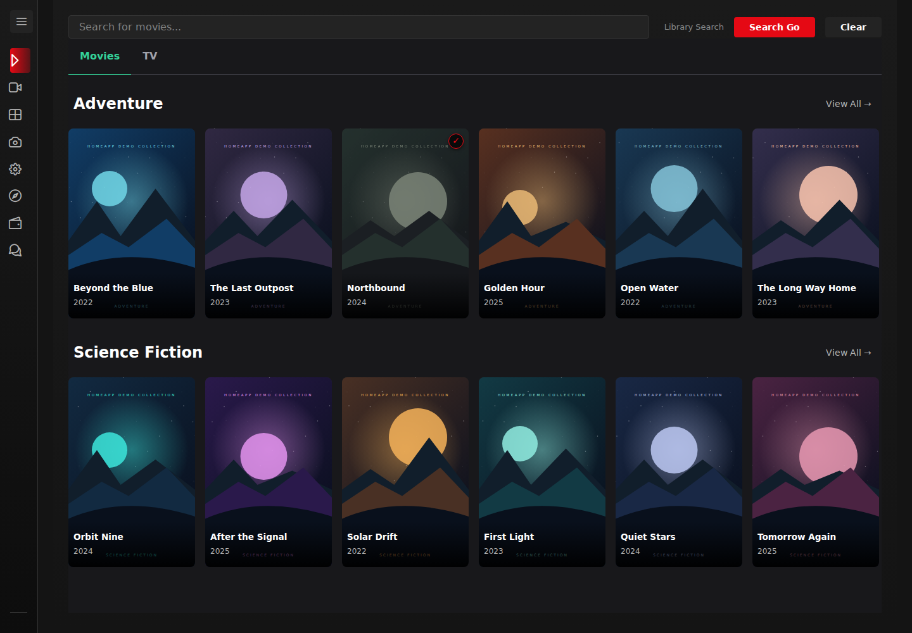

> Screenshots show the real application UI with fictional sample data intercepted
> by Playwright. Movie artwork, receipts, map tiles, and camera illustrations are
> original demo assets. No personal records, addresses, or credentials are shown.

## A look inside

| Make it part of your day | What HomeApp brings together |
| --- | --- |
| **Movie night** | Genre shelves, searchable libraries, episode browsing, watched status, and browser or host TV playback |
| **Receipt to record** | Photo capture, AI-assisted extraction, editable review, saved receipt images, and purchased items |
| **Spending at a glance** | Monthly charts, category breakdowns, merchant insights, filtered history, and CSV exports |
| **Smarter shopping** | Compare what you paid for receipt items across stores and purchases |
| **Your AI workspace** | Streaming replies, Markdown rendering, saved conversations, and configurable model endpoints |
| **Before you leave** | Saved routes, pinned traffic cameras, road reports, marine positions, and advisory bridge lift estimates |

### Movie night, from your own library

Browse movies by genre, search for a title, and open its details before choosing
where to watch. Play in the browser, send playback to the host's VLC service,
or copy a playback URL. TV libraries organize episodes into season accordions
and keep track of what you have watched.

Media sources are configurable in Settings. Scan selected files, refresh
metadata from OMDb, or edit a movie or series yourself. Additional mounted
storage locations can feed the same library.

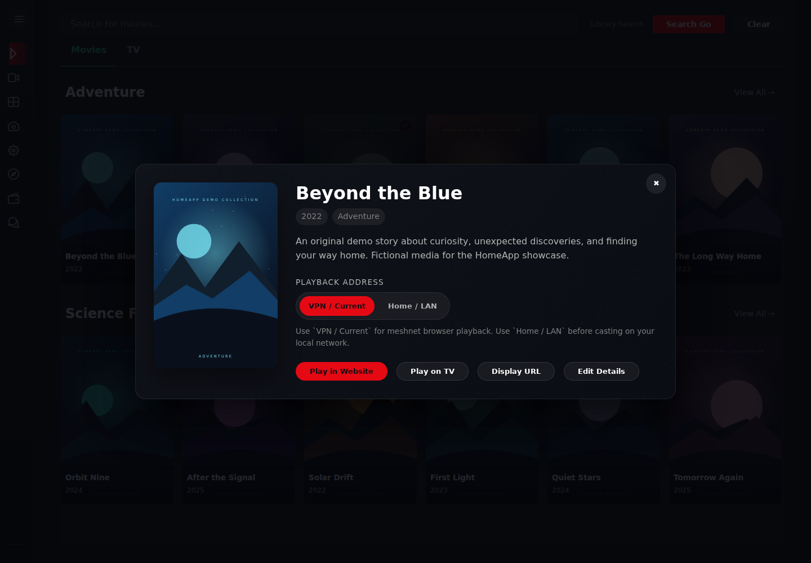

<details>
<summary><strong>See the TV season and episode browser</strong></summary>

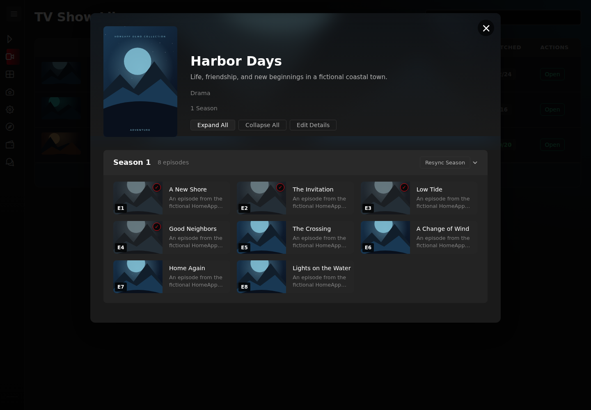

</details>

### A receipt photo becomes an expense you can review

Take a photo on your phone, upload an image, or enter an expense manually.
AI-assisted extraction fills in the merchant, date, currency, category, and
amounts. Review and correct the fields before saving; the receipt image and
purchased items stay with the expense.

Import bank or card CSV exports and inspect the row-by-row results. Likely
duplicates can be skipped, while uncertain rows wait for your approval.
Search and filter your expense history, mark work or reimbursable purchases,
and export the current view to CSV.

<details open>
<summary><strong>See receipt capture, extracted items, and the review step</strong></summary>

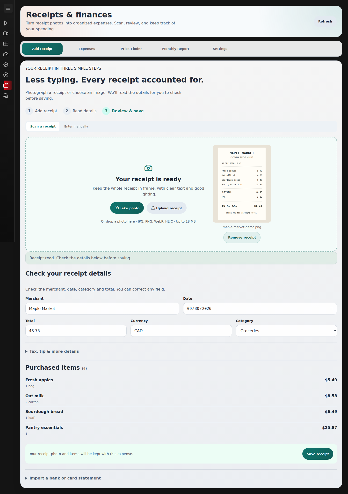

</details>

### See the shape of your spending

Monthly reports turn saved purchases into daily spending trends, category
shares, weekday patterns, and merchant insights. Narrow the date window or
focus on a category, and exclude reimbursable expenses when reviewing household
spending. The report also shows a full-month projection based on the current
run rate.

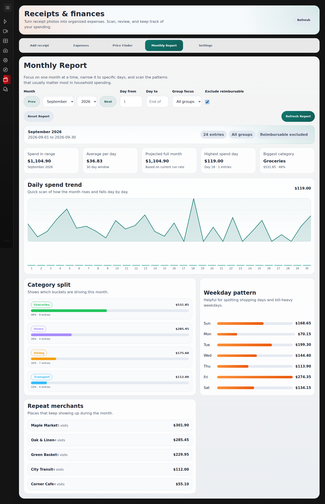

The **Price Finder** compares prices from your own itemized receipts. Expand
an item to see its purchase history and which store had the lowest recorded
price. Reclassify item names to group related purchases together.

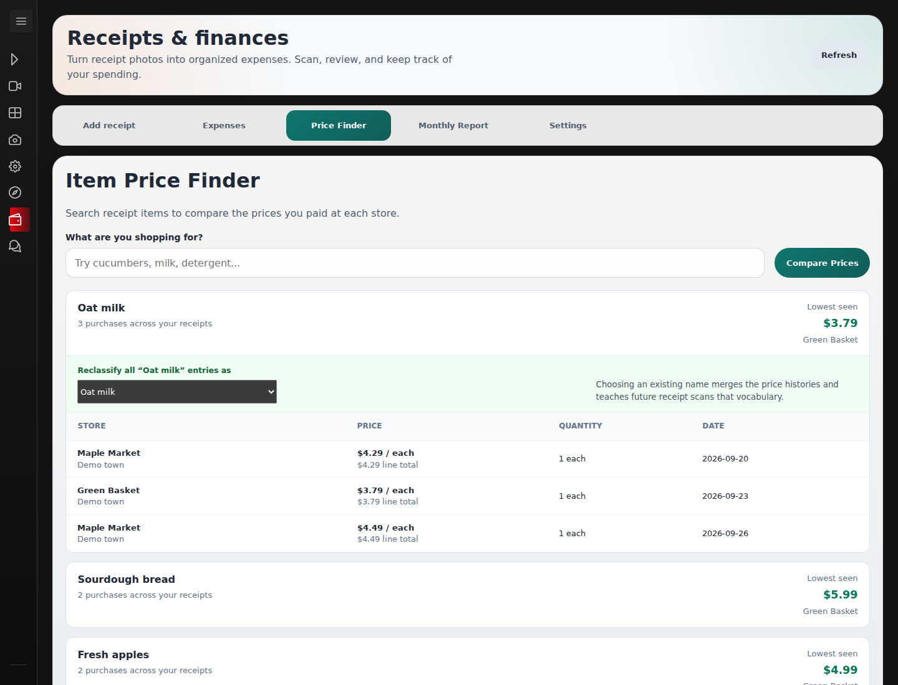

### Keep your conversations, choose your model

Start a conversation, stream replies, and return to a saved session later.
Responses render Markdown, including tables, lists, and code blocks. Choose
from the enabled models configured in Settings; chat sessions and messages
are stored in PostgreSQL.

Model settings include provider, base URL, model name, and request parameters.
OpenAI-compatible endpoints can point to a hosted provider or a compatible
local model server. API keys are supplied through environment variables;
Settings stores their variable names.

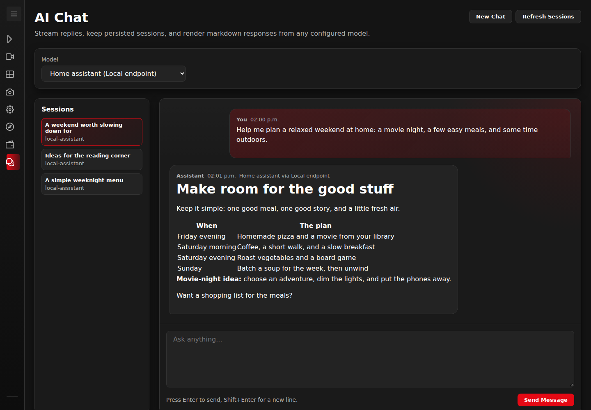

### Build the commute view you want to check

Save your own routes and assemble dashboards with favorite camera views and
panels in your preferred order. Check road incidents, lane works, conditions,
and feed freshness alongside the route you monitor.

The map brings the route, traffic cameras, road reports, ships, and a configured
lift bridge together. Open markers for more detail, reverse a saved trip, or
follow the route in Google Maps. Marine monitoring uses AIS positions to provide
advisory lift windows when a vessel approaches the configured crossing.

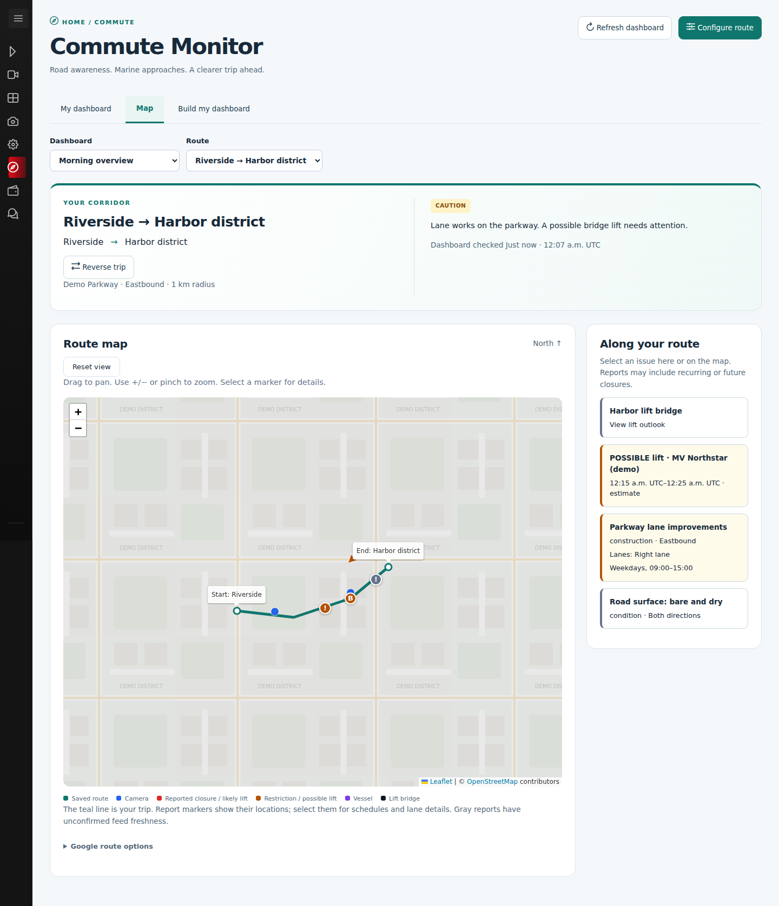

<details>
<summary><strong>See the dashboard and its custom builder</strong></summary>

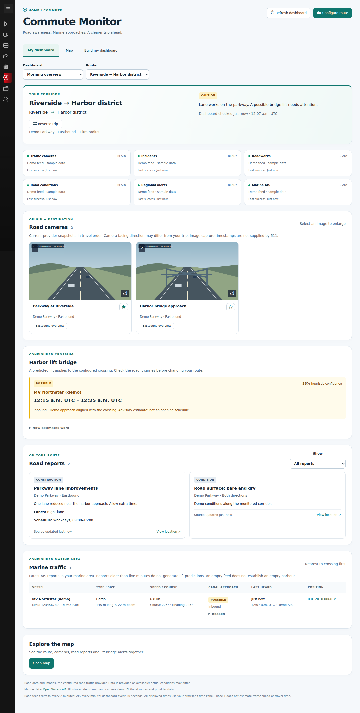

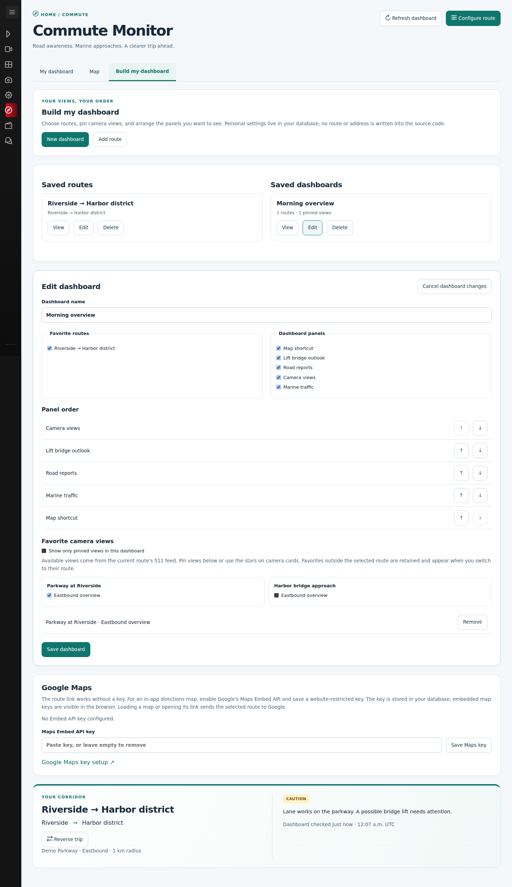

</details>

Commute monitoring provides road awareness rather than driving-time estimates.
Lift windows and confidence scores are heuristics, not confirmed opening
schedules. Provider availability and AIS coverage can be incomplete.
See the [Commute Monitor guide](docs/commute-monitor.md) for configuration and limits.

### From desktop to phone

Receipt capture supports the phone camera, and commute views adapt to a narrow
screen. These captures use a 390-pixel mobile viewport.

<p align="center">
  <a href="docs/screenshots/receipt-mobile.png">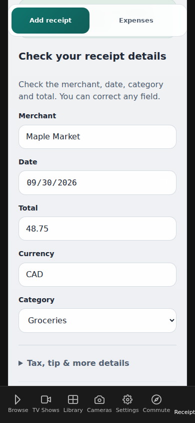</a>
  &nbsp;&nbsp;
  <a href="docs/screenshots/commute-mobile.png">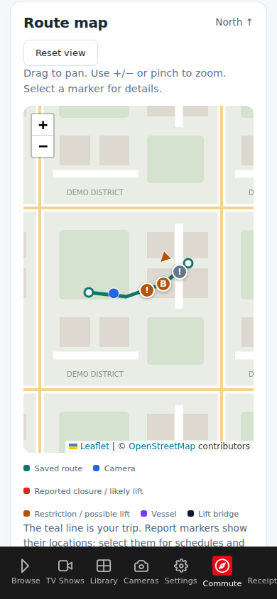</a>
</p>

## Get started

Install **Docker with Compose**, **.NET SDK 10**, and **Node.js 24**, or open the
[VS Code development container](.devcontainer/README.md).

From the repository root:

```bash
cp .env.example .env
```

Replace password and token placeholders, set your media and document paths,
and configure `POSTGRES_CONNECTION` with `Host=127.0.0.1`, your `POSTGRES_PORT`,
and the same database credentials as `POSTGRES_DB`, `POSTGRES_USER`, and
`POSTGRES_PASSWORD`. Optional provider keys can stay absent.

Start PostgreSQL and the backend:

```bash
docker compose --env-file .env up -d --wait postgres
dotnet run --project backend/Core/HomeApp.Host/HomeApp.Host.csproj \
  --urls http://localhost:5000
```

In a second terminal, start the frontend:

```bash
cd frontend
npm ci
npm start
```

Open **http://localhost:4200**. The backend applies schema migrations at startup.
Add media folders and model endpoints in **Settings**, upload your first receipt,
or create a route in **Commute → Build my dashboard**.

## Run it at home

The [deployment guide](DEPLOYMENT.md) covers versioned Docker images, Compose,
private registry access, media mounts, optional camera services, and host-side
VLC setup for TV playback. The [short setup guide](setup.md) gives a deployment
checklist.

**Keep access private.** HomeApp has no built-in user login. App and
administrative ports bind to localhost by default; use SSH forwarding, a private
VPN, or an authenticated reverse proxy for remote access. CORS does not provide
authentication. Protect and back up receipts, chat history, routes, and settings.

Local environment files, credentials, runtime data, and private SQL seeds are
excluded from Git and Docker build contexts. The optional private port catalogue
is Git-ignored but is bundled with the frontend when supplied locally; include
only data you intend to serve to app users. Hosted AI providers and commute
services receive the requests needed for their enabled features.

## Built to inspect and release

The Compose monitoring stack includes **Grafana, Tempo, Prometheus, Loki, and
an OpenTelemetry Collector**. Follow application and AI traces, metrics, and
logs with the [provisioned HomeApp dashboard](monitoring/grafana/provisioning/dashboards/homeapp-telemetry.json).

GitHub Actions runs production builds, tests, dependency auditing, and Git
history secret scanning. Dependabot checks npm, NuGet, Docker, development
containers, and Actions updates weekly.

**Release flow:** Conventional Commits on `main` → Release Please version and
changelog PR → merge the release PR → version tag and a direct Docker build and
push to the private registry. Release Please uses GitHub's built-in bot account;
no GitHub PAT is required. The Docker workflow attaches the image reference and digest
to the GitHub Release. See [release setup](DEPLOYMENT.md#release-from-github-actions)
for variables, tokens, and manual retries.

<details>
<summary><strong>Development checks</strong></summary>

```bash
dotnet test backend/Core/HomeApp.sln --configuration Release
dotnet publish backend/Core/HomeApp.Host/HomeApp.Host.csproj \
  --configuration Release -p:UseAppHost=false --output /tmp/homeapp-publish
cd frontend
npm ci
npm audit
npm run build -- --configuration production
npm test -- --watch=false
npm run test:vessels
```

Screenshot captures and the fictional fixtures are repeatable; see the
[screenshot guide](docs/screenshots/README.md#recreate-the-screenshots).

</details>

## Explore the repository

| Location | What's there |
| --- | --- |
| [`frontend`](frontend) | Angular UI and browser checks |
| [`backend/Core`](backend/Core) | ASP.NET modules, application host, and tests |
| [`backend/Library`](backend/Library) | Shared database and raster image infrastructure |
| [`backend/PythonServices`](backend/PythonServices) | Optional camera services and host VLC control |
| [`monitoring`](monitoring) | Collector configuration and provisioned dashboards |
| [`scripts`](scripts) | Image build, deployment, and host setup helpers |
| [`docs`](docs) | Module guides and future designs |

The [financial platform design](docs/financial-platform-production-design.md)
describes future work. The features shown above reflect the current application.

## License

HomeApp source is licensed under [MIT](LICENSE). Third-party packages and optional
media or catalogue data retain their own licenses.
