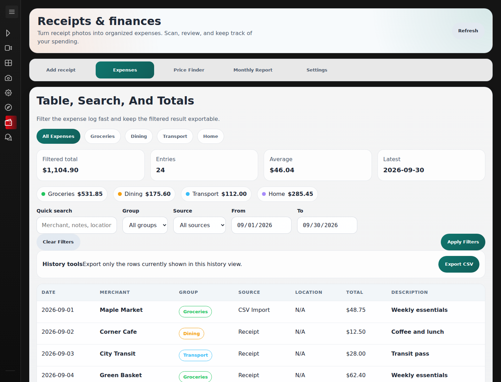
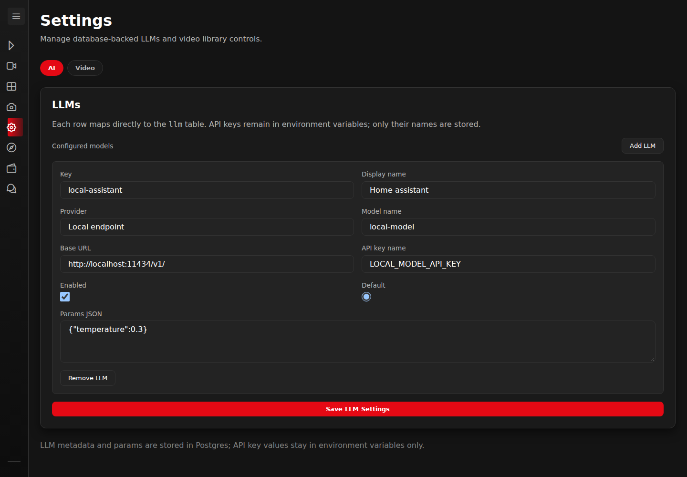

# HomeApp screenshot gallery

These are Playwright screenshots of the actual Angular application, using
fictional API fixtures. The browser never reads or writes application data.
The receipt, media posters, camera illustrations, and map tiles are original
SVG demo artwork rendered in the browser. The AI conversation is a sample
response, and commute feed status, vessel positions, and lift windows are
synthetic. These captures demonstrate the UI rather than live provider results.

## Media

| Browse by genre | Choose where to play |
| --- | --- |
| [](media-library.png) | [](media-details.png) |

[](tv-series.png)

## Receipts and spending

| Review before saving | Compare recorded prices |
| --- | --- |
| [](receipt-review.png) | [](price-finder.png) |

[](spending-report.png)

<details>
<summary>Expense history, search, and exports</summary>

[](expense-history.png)

</details>

## AI workspace

[](ai-chat.png)

<details>
<summary>Model and endpoint configuration</summary>

[](model-settings.png)

</details>

## Commute awareness

[](commute-map.png)

| Personal dashboard | Dashboard builder |
| --- | --- |
| [](commute-dashboard.png) | [](commute-builder.png) |

## Mobile

<p align="center">
  <a href="receipt-mobile.png"></a>
  &nbsp;&nbsp;
  <a href="commute-mobile.png"></a>
</p>

## Recreate the screenshots

The capture script uses a separate development server. It does not require
PostgreSQL, a running backend, provider API keys, `.env`, or personal media.
Install frontend dependencies with `npm ci` if needed, then start it from the
repository root:

```bash
cd frontend
BASE_IP=http://127.0.0.1:9 npm start -- --host 127.0.0.1 --port 4310
```

The deliberately unused backend address prevents server-side rendering from
contacting a live backend. In another terminal at the repository root, install
Playwright in a temporary folder so the app's dependencies remain unchanged:

```bash
SHOWCASE_TOOLS_DIR="$(mktemp -d /tmp/homeapp-showcase-tools.XXXXXX)"
npm install --prefix "$SHOWCASE_TOOLS_DIR" playwright
"$SHOWCASE_TOOLS_DIR/node_modules/.bin/playwright" install chromium
PLAYWRIGHT_MODULE_PATH="$SHOWCASE_TOOLS_DIR/node_modules/playwright/index.mjs" \
  node frontend/e2e/showcase-screenshots.mjs
```

If Chromium reports missing Linux libraries, install its system dependencies
with `playwright install-deps chromium` using the same temporary installation.

The script overwrites the 14 showcase PNG files in this directory. Use
`SHOWCASE_BASE_URL` to target a different local frontend URL. Desktop captures
use a 1440-pixel viewport; mobile captures use 390 × 844. The browser uses dark
color preference, UTC, and `en-CA` formatting. External Google Fonts requests
are blocked so the app uses its system font fallback consistently.

All `/api/` requests are intercepted; unknown endpoints fail the capture rather
than reaching the backend. The optional private port catalogue and public map
tiles are intercepted too. The script exercises browser controls for media
details, season expansion, receipt upload and review, reporting, price comparison,
chat history, map navigation, and dashboard editing. It checks for unexpected
API calls, JavaScript errors, and horizontal overflow on the two mobile screens.
It does not verify real provider extraction, playback, database writes, or
traffic-feed availability.

The older `commute-desktop.png` capture is retained for existing references.
